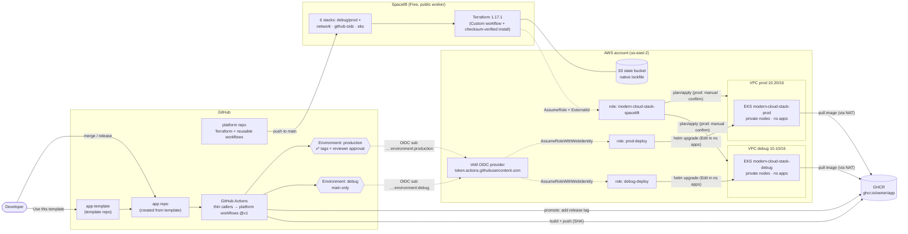

# platform

The platform half of a small, working internal developer platform on AWS. This repo holds the
infrastructure (Terraform components, run by Spacelift) and the reusable GitHub Actions workflows
that every app calls. Its companion, [`app-template`](https://github.com/sockstabby/app-template),
is a GitHub template repo: a new service gets a FastAPI app, a Dockerfile, a Helm chart and three
thin workflow files, and from then on merging to `main` deploys to a `debug` EKS cluster and
publishing a release promotes the same image to `prod` after a reviewer approves. It demonstrates
component-scoped infrastructure state, keyless CI/CD (GitHub OIDC and Spacelift both assume IAM
roles; there are no static AWS keys anywhere), least-privilege Kubernetes access, versioned
reusable workflows, and prod gating in both the infra and the app pipeline.

Everything below was built and run end to end on 2026-11-09 (us-east-2, EKS 1.37, Terraform
1.17.1, Helm 4.3.1).

## Contents

- [Architecture](#architecture)
- [Repo layout](#repo-layout)
- [Design decisions and tradeoffs](#design-decisions-and-tradeoffs)
- [Reusable workflows](#reusable-workflows)
- [Reusable workflow versioning](#reusable-workflow-versioning)
- [Cost](#cost)
- [Setup from scratch](#setup-from-scratch)
- [Teardown](#teardown)
- [Gotchas hit while building this](#gotchas-hit-while-building-this)
- [Next steps](#next-steps)

## Architecture



Two trust paths, both keyless:
- **Spacelift → AWS:** Spacelift's AWS account assumes `modern-cloud-stack-spacelift`, and only
  with an ExternalId matching `sockstabby@*@<one of the six stack names>@*`.
- **GitHub → AWS → EKS:** a job that declares a GitHub Environment gets an OIDC token whose `sub`
  ends in `:environment:<name>`. Each environment's deploy role trusts only its own environment,
  can only `eks:DescribeCluster` its own cluster, and inside the cluster can only edit namespace
  `apps`.

## Repo layout

```
bootstrap/                  # applied once, locally: state bucket, GitHub OIDC provider, Spacelift role
components/terraform/
  network/                  # VPC, 2 public + 2 private subnets, 1 NAT, S3 gateway endpoint
  github-oidc/              # per-env deploy role trusting GitHub OIDC (references the bootstrap provider)
  eks/                      # cluster, managed node group, add-ons, access entries, `apps` namespace
stacks/{debug,prod}/*.tfvars  # the only per-environment difference: names, CIDRs, node counts
.spacelift/                 # config.yml (version + hooks), workflow.yml (Custom tool), install-terraform.sh
.github/workflows/          # reusable-{build,chart-test,deploy,promote}.yml + version drift check
scripts/check-terraform-version.sh
docs/                       # spacelift-setup.md, oidc-verification.md, teardown.md
```

Apply order per environment: `network → github-oidc → eks`; destroy in reverse. Components find
each other by **tags and names** (`data "aws_vpc"` by `project`/`environment` tags, the deploy role
by name), not by `terraform_remote_state`, so no component can read another's state.

## Design decisions and tradeoffs

Each entry: what we did, why, and what a production setup would do differently.

### Components with separate state
**Did:** three components per environment, each its own Spacelift stack and its own state file
(`<env>/<component>.tfstate`), plus `bootstrap/`.
**Why:** blast radius and speed. An app-facing change to the cluster can't touch the VPC; a
broken plan in one component blocks only that stack; prod and debug share code but never state.
**Cost:** cross-component wiring is by lookup (tags, names), so apply order matters and is
documented rather than enforced.
**Production:** the same split, with Spacelift stack dependencies (or Atmos) to enforce ordering and
pass outputs explicitly.

### Terraform via Spacelift's Custom workflow (not OpenTofu)
**Did:** HashiCorp Terraform 1.17.1 (exact pin), run by Spacelift's *Custom* workflow tool
(`.spacelift/workflow.yml`). A hook (`.spacelift/install-terraform.sh`) downloads the pinned release
and `SHA256SUMS` from releases.hashicorp.com, verifies the checksum, fails on mismatch, and installs
the binary. The build originally targeted OpenTofu and switched mid-build.

**Why Custom is needed:** Spacelift supplies only open-source Terraform (MPL 2.0, up to 1.5.7) and
OpenTofu. Releases after 1.5.7 are under the Business Source License 1.1, so Spacelift won't
download them for us. We need >= 1.10 for native S3 state locking (`use_lockfile`), so we bring our
own binary.

**Licensing:** my reading of BSL 1.1 and
[HashiCorp's licensing FAQ](https://www.hashicorp.com/license-faq) is that using Terraform to manage
your own infrastructure is permitted, and that the restriction targets products offered to third
parties that compete with HashiCorp's (see the FAQ's questions on "competitive offering" and on
hosting internally). This is not a legal conclusion; anyone adopting this pattern commercially
should check with their own counsel.

**Costs of this choice:**
- A supply-chain step we own: a binary is downloaded on every run. Mitigated by an exact pin and
  checksum verification (GPG verification of `SHA256SUMS.sig` is a next step).
- Hooks are needed before init, apply **and** destroy: a run paused for confirmation (every prod
  run) resumes in a phase where previously installed tools may be gone. The hook is idempotent; in
  this build's runs it reported `terraform 1.17.1 already installed` before apply.
- One version in several places. `TERRAFORM_VERSION` in `.spacelift/config.yml` is the single
  source; `scripts/check-terraform-version.sh` runs in the Spacelift hook and in CI and fails if any
  `required_version` or `.tool-versions` drifts.

**Production:** bake Terraform into a custom runner image (no per-run download), or use OpenTofu,
which Spacelift supports natively.

### Spacelift for infrastructure, GitHub Actions for apps
**Did:** Spacelift owns every Terraform state; Actions owns only Helm releases in `apps`.
**Why:** one owner per piece of state. Infra changes get Spacelift's plan review, confirmation and
history; app teams ship many times a day without needing infra permissions. The GitHub deploy roles
can't change AWS at all beyond reading their own cluster's endpoint.
**Production:** same split; add Spacelift policies (plan approval, drift) and GitOps for apps.

### Template plus reusable workflows, with a major-tag contract
**Did:** `app-template` holds thin callers (`ci.yml`, `deploy-debug.yml`, `deploy-prod.yml`); all
logic is in this repo's reusable workflows, called as `@v1`.
**Why:** a template is copied once; repos made from it never receive later fixes. Workflow refs can
be bumped, and with a floating major tag a fix lands once and reaches every app. The contract is in
[Reusable workflow versioning](#reusable-workflow-versioning).
**Production:** same, plus Copier (or similar) so the non-workflow template files can be updated
too, and Renovate to bump major tags.

### Two repos: platform vs. one repo per app
**Did:** `platform` (infra + workflows) and one repo per app.
**Why:** ownership (platform team vs. app team), blast radius (an app PR can't touch infra), and
change cadence (apps deploy constantly; infra changes are rare and reviewed). Tags on `platform`
cover both infra and workflows; Spacelift tracks `main`, so workflow-only releases don't touch infra.
**Production:** the same, often with infra split further (network/account baseline vs. clusters).

### Push deploys instead of GitOps
**Did:** Actions runs `helm upgrade --install` against the cluster.
**Why:** fewest moving parts for a two-environment demo, and the whole path (build → promote →
deploy) is visible in one workflow run. Helm 4's `--rollback-on-failure --wait` (Helm 4's
replacement for v3's `--atomic`) gives a safe failure mode.
**Cost:** CI needs network access and credentials to the cluster (hence the public endpoint and the
deploy roles); drift between Git and the cluster isn't detected.
**Production:** GitOps with Argo CD: CI only builds and bumps an image tag in Git; the cluster pulls.
The cluster API can then be private and CI needs no cluster credentials.

### Private nodes behind one NAT per environment
**Did:** nodes and the EKS control-plane ENIs sit in private subnets; one NAT gateway per
environment (in one AZ) provides egress; an S3 gateway endpoint keeps S3 traffic off the NAT.
**Why:** no node has a public IP; one NAT costs ~$0.045/h instead of ~$0.09/h for two.
**Cost:** if that AZ fails, nodes in the other AZ lose egress (image pulls from GHCR fail).
**Production:** one NAT per AZ (`single_nat_gateway = false, one_nat_gateway_per_az = true`), plus
ECR with VPC endpoints so image pulls don't need the internet at all.

### Public EKS API endpoint
**Did:** public and private endpoints both on; public access open to `0.0.0.0/0` (variable
`endpoint_public_access_cidrs`). Authentication is still IAM plus access entries.
**Why:** GitHub-hosted runners and Spacelift's public worker come from large, changing IP ranges, and
both must reach the API (Helm deploys; Terraform creating the `apps` namespace).
**Production:** private-only endpoint, with self-hosted runners and a Spacelift private worker inside
the VPC (or GitOps, so nothing outside the cluster needs the API).

### Single AWS account
**Did:** debug and prod in one account, separated by VPC, cluster, IAM role, state key and tags.
**Why:** a shortcut for a one-day build.
**Production:** AWS Organizations with separate accounts per environment (and for shared services
and logging); per-account Spacelift integrations; SCPs as guardrails.

### Per-environment OIDC roles with environment-scoped trust
**Did:** one deploy role per environment. Trust: `aud = sts.amazonaws.com` and
`sub` like `repo:sockstabby@17520257/*:environment:<env>` (this account uses GitHub's
immutable-ID `sub` format). Permissions: `eks:DescribeCluster` on that environment's cluster only.
In-cluster: an EKS access entry with `AmazonEKSEditPolicy` **scoped to namespace `apps`**.
**Why:** a workflow can only get prod credentials by running in the `production` Environment, which
requires approval; and even with credentials it can't touch other namespaces, read `kube-system`
secrets or create namespaces. The `*` lets any repo created from the template deploy without IAM
changes; within each repo, the Environment's branch/tag policy decides which refs can deploy.
**Verified:** a temporary workflow printed the real claims and checked permissions; see
[docs/oidc-verification.md](docs/oidc-verification.md).
**Production:** per-repo trust (or an allow-list via `repository_id`), plus `job_workflow_ref`
conditions so only the platform's reusable deploy workflow can assume the role.

### Prod gated in both Spacelift and GitHub
**Did:** prod stacks have autodeploy **off**, so every prod apply stops at *Unconfirmed* until a
person confirms it in Spacelift. The `production` GitHub Environment requires a reviewer and only
accepts `v*` tags. ("Prevent self-review" is off, because this is a one-person project; with it on,
the only reviewer could never approve.)
**Why:** infra and app changes reach prod through different pipelines, so each needs its own gate.
**Production:** Spacelift approval policies (OPA) with more than one approver; required reviewers
from a team with self-review prevented; deployment windows.

### Promote by re-tagging, never rebuild
**Did:** a release runs `reusable-promote`, which adds the release tag to the image already built
for that commit (`docker buildx imagetools create`, a registry-side manifest copy), then deploys it.
**Why:** prod runs the exact bytes that ran on debug. For `v0.1.0`, both tags resolve to the same
digest (`sha256:e96f291b…`). If the commit was never built on `main`, promotion fails with a clear
error instead of building something untested.

### Small decisions worth knowing
- **The `apps` namespace is created by the `eks` component** (via the `kubernetes` provider),
  because the deploy role can't create namespaces. Configuring a provider from a cluster in the same
  configuration is a known caveat (fine for create/destroy, can fail if the cluster must be
  replaced); production would manage namespaces separately.
- **Access entries are explicit.** `enable_cluster_creator_admin_permissions` is off; the Spacelift
  role and the admin user get named entries. The creator flag keys off whoever runs the plan, so a
  local plan and a Spacelift plan differed and a local apply would have duplicated an entry.
- **No KMS key and no control-plane logs** in this lab (a module-made KMS key can only be scheduled
  for deletion and bills meanwhile; log groups get orphaned). Production enables both.

## Reusable workflows

| Workflow | Does | Caller grants | Key inputs |
|---|---|---|---|
| `reusable-build.yml` | Build image; push to `ghcr.io/<owner>/<name>:<tag>` if `push` | `contents: read` (+ `packages: write` to push) | `image-name`, `image-tag` (default SHA), `push` |
| `reusable-chart-test.yml` | `helm lint` every values file; kind cluster in the runner; install; curl `/healthz` | `contents: read` | `release-name` |
| `reusable-deploy.yml` | OIDC role → `aws eks update-kubeconfig` → `helm upgrade --install --rollback-on-failure --wait` | `contents: read`, `id-token: write` | `environment`, `image-name`, `image-tag`, `values-file` |
| `reusable-promote.yml` | Add a release tag to an existing image (no rebuild) | `contents: read`, `packages: write` | `image-name`, `source-tag`, `target-tag` |

Workflows declare no `permissions:` of their own; a called workflow can only keep or reduce what the
caller grants, so each caller grants exactly what that job needs. Deploy jobs run on
`ubuntu-24.04` (pinned, because `ubuntu-latest` moves to 26.04 in November 2026) and read
`AWS_ROLE_ARN` and `EKS_CLUSTER_NAME` from the app repo's GitHub Environment (variables, not
secrets: neither is sensitive). Every third-party action is pinned to a full commit SHA.

## Reusable workflow versioning

App repos call the workflows in this repo by **major tag**, e.g.
`sockstabby/platform/.github/workflows/reusable-build.yml@v1`.

Why: a GitHub template is copied once. Repos created from it never receive later template
changes, but a workflow ref can be bumped. Keeping all CI/CD logic here and only thin callers in
the app repos means a fix lands once and every app picks it up.

**Tags**
- Every release gets a semver tag: `v1.0.0`, `v1.1.0`, `v1.1.1`, ...
- A floating major tag (`v1`) points at the latest `v1.x.y`.

**Non-breaking changes** (new *optional* inputs, new workflows, bug fixes, internal refactors):
release a new minor/patch tag and move `v1` to it. Existing apps pick up the change automatically.

**Breaking changes** (removing/renaming inputs, secrets or outputs; making an input required;
changing deploy behaviour an app relies on): release `v2.0.0` and create a new `v2` tag.
**Never move `v1` to a breaking change.** Apps opt in by changing `@v1` to `@v2`.

**Deprecation:** keep `v1` working until every app repo has moved off it. Announce deprecations
here and in the workflow output with `::warning::`.

**Scope:** infra and workflow code share this repo, so one tag covers both. Workflow-only
releases are fine; Spacelift stacks track `main`, not tags, so they are unaffected.

The template's `ci.yml`, `deploy-debug.yml` and `deploy-prod.yml` always reference the current
major tag. Every release is recorded in [CHANGELOG.md](CHANGELOG.md) (`v1.0.0` build + chart test,
`v1.1.0` deploy, `v1.2.0` promote; all non-breaking).

**Releasing** (maintainer):
```sh
git tag -a v1.2.0 -m "v1.2.0"            # immutable release tag
git tag -f v1 v1.2.0^{commit}            # move the floating major tag (non-breaking only!)
git push origin v1.2.0 && git push -f origin v1
```

**Private repos:** these repos are public, so cross-repo `uses:` just works. If `platform` were
private, it would need *Settings → Actions → General → Access* set to allow other repos to use its
workflows.

## Cost

us-east-2 on-demand prices, **checked 2026-11-09** on the AWS pricing pages for EKS, VPC (NAT
gateway, public IPv4), EC2 and EBS. Spacelift Free and GHCR public packages cost $0.

| Item | Rate | Per env | Both envs |
|---|---|---|---|
| EKS control plane (standard support) | $0.10/h | $0.100/h | $0.200/h |
| NAT gateway | $0.045/h | $0.045/h | $0.090/h |
| Public IPv4 (NAT's Elastic IP; nodes have none) | $0.005/h | $0.005/h | $0.010/h |
| Nodes: 2 × t3.medium | $0.0416/h each | $0.083/h | $0.166/h |
| Node disks: 2 × 20 GB gp3 | $0.08/GB-month | ~$0.004/h | ~$0.009/h |
| **Total (before data)** | | **~$0.24/h · ~$5.70/day** | **~$0.48/h · ~$11.40/day** |

Not included: NAT data processing ($0.045/GB; image pulls are the main traffic, a few hundred MB
for this app), S3 state storage (cents), and data transfer out. Debug runs 2 nodes (min 1); prod
needs 2 (min 2) for its two zone-spread replicas.

## Setup from scratch

1. **Tools:** `mise install` reads `.tool-versions` (Terraform 1.17.1, Helm 4.3.1, kubectl, kind).
   An AWS CLI profile with admin rights in the target account.
2. **Bootstrap** (local, once):
   `cd bootstrap && mise exec -- terraform init && mise exec -- terraform apply`. Creates the state
   bucket, the GitHub OIDC provider and the Spacelift role. Set `spacelift_aws_principal` for your
   Spacelift region (`spacelift.io` = 324880187172, `us.spacelift.io` = 577638371743).
3. **Spacelift:** AWS integration + six stacks, in the UI or via the GraphQL API:
   [docs/spacelift-setup.md](docs/spacelift-setup.md). Apply `network → github-oidc → eks` per
   environment; verify the private route table points at the NAT before applying `eks`.
4. **App repo:** create it from `app-template` and follow its README (GitHub Environments
   `debug` and `production` with `AWS_ROLE_ARN` / `EKS_CLUSTER_NAME`; first merge; make the GHCR
   package public; first release).

## Teardown

Full procedure and final checks: **[docs/teardown.md](docs/teardown.md)**. In short:
`helm uninstall` in both clusters → destroy `eks → github-oidc → network` per environment through
Spacelift (prod destroys need confirmation) → optionally empty the versioned state bucket and
destroy `bootstrap/` locally → deactivate the IAM user's access key → confirm with
`aws resourcegroupstaggingapi get-resources --tag-filters Key=project,Values=modern-cloud-stack`
plus explicit checks for NAT gateways, Elastic IPs, load balancers and volumes.

## Gotchas hit while building this

| Symptom | Cause | Fix |
|---|---|---|
| Spacelift: `unauthorized: you need to configure trust relationship` when attaching the integration | Trust policy named the EU Spacelift account; the account is on `us.spacelift.io` | Use `577638371743` for the US region. `awsIntegration { externalIdForStack }` returns the exact statement Spacelift expects |
| `sub` didn't look like `repo:OWNER/REPO:...` | Repos created after 2026-07-15 use GitHub's immutable format `repo:OWNER@OWNER_ID/REPO@REPO_ID:...` | Trust `repo:sockstabby@17520257/*:environment:<env>`; verified by printing the claim |
| Local and Spacelift EKS plans differed | `enable_cluster_creator_admin_permissions` depends on the caller | Explicit access entries |
| Permission-check step aborted on the first expected "no" | `kubectl auth can-i` exits 1 for "no"; Actions runs `bash -e` | Compare output, ignore exit code |
| A new image can't be pulled by the cluster | GHCR packages start **private**, even from a public repo | Make the package public once (Package settings → Change visibility); GitHub's docs describe only this UI path |
| `helm history` shows `APP VERSION dev` | `appVersion` comes from `Chart.yaml`; `helm upgrade` can't override it | Cosmetic; the app's `/version` reports the deployed tag. Production would set `appVersion` at package time |
| Terraform `use_lockfile` needs >= 1.10 | Spacelift only supplies Terraform <= 1.5.7 | Custom workflow + install hook (above) |

## Next steps

- **NAT per AZ** so one AZ failure doesn't cut egress for the other.
- **Private-only EKS endpoint** with self-hosted runners and a **Spacelift private worker** in the VPC.
- **Atmos** for stack configuration (inheritance across envs/regions instead of per-env tfvars).
- **Copier** for the template, so existing apps can pull template updates beyond workflows.
- **Argo CD** (GitOps): CI bumps a tag in Git; the cluster pulls; no cluster credentials in CI.
- **AWS Load Balancer Controller + Ingress** for real traffic (today the service is ClusterIP only).
- **ECR** with pull-through cache and VPC endpoints, so nodes pull images without the NAT.
- **Multi-account** with AWS Organizations (prod isolated from debug; SCPs).
- **Spacelift admin stack**: stacks, integrations and env vars as code (Spacelift Terraform
  provider) instead of UI/API calls.
- **OPA policies** in Spacelift (plan approval, required tags, no public resources).
- **Drift detection** on prod stacks.
- **Karpenter** for node autoscaling and spot capacity.
- **GPG-verify** `SHA256SUMS.sig` in the Terraform install hook.
